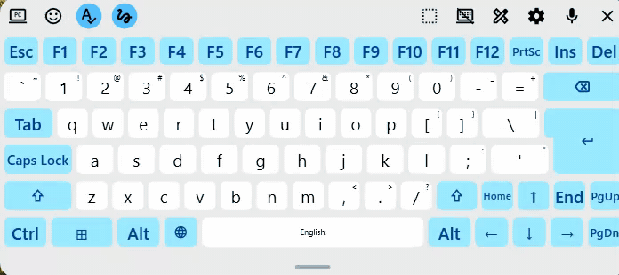
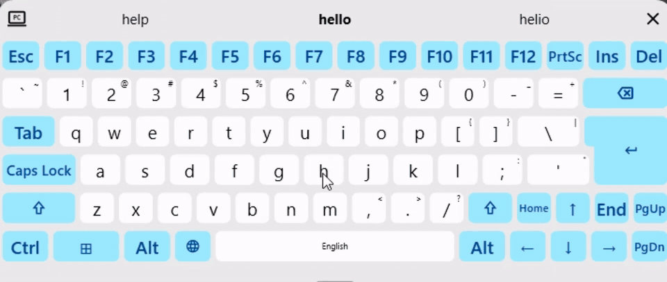
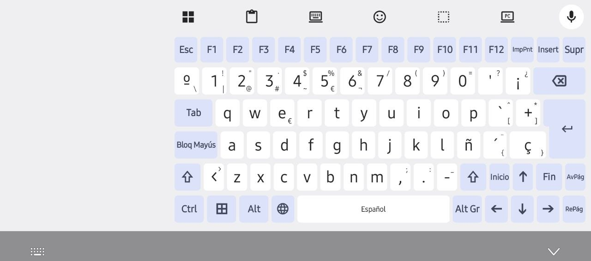
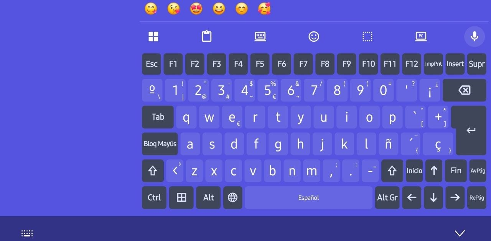
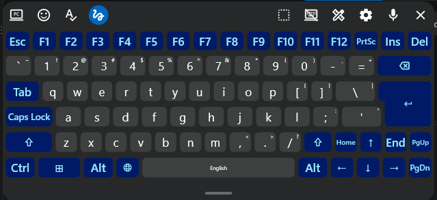
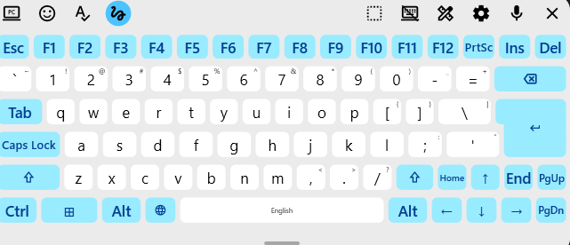
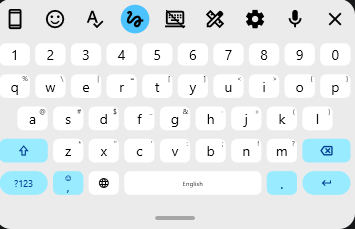
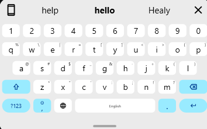
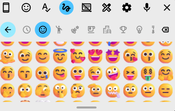

# KeyPlus

**A keyboard made for productivity, that uses AI to do more, privately**: for working
remotely, adding the keys you miss on Android (Esc, Tab, Ctrl, Alt, F1–F12,
the arrows, Home, End, Page up and Page down), and for XR devices such as XREAL glasses, the INAIR Pod, the
Galaxy XR and Meta Quest. Real keyboards for remote programming, from any
device based on Android.

**Three AI models, all local**:

1. **Glide typing** reads your finger's trail with a neural model (FUTO
   Swipe's), on the device itself.
2. **Accents** put back by a model that reads the whole sentence ("como
   estas hoy?" becomes "cómo estás hoy?"), on the device itself.
3. **Voice typing** writes what you say with NVIDIA's speech model
   (Nemotron), on a computer of your own.

Your words never go to anyone else's cloud.

Those keys go to the field being typed in: a terminal, an SSH app, or a
web editor such as vscode.dev or code-server in the browser. Two products, two apps built from the same code, which can be
on one phone together:

- **KeyPlus** (the popup, `ai.berpiztu.keyplus`): the keys in a strip right
  above whatever keyboard is open. It works beside the keyboard you already
  use; it does not replace it.
- **Berpiztu AI Keyboard** (`ai.berpiztu.keyboard`): the same keys and
  title bar as a keyboard of its own, for any Android, and the one for a
  headset (Galaxy XR).

And with it:

- **On INAIR's pod too**, which lets you use only the keyboards it comes
  with: Berpiztu AI Keyboard turns itself on there, from the keyboard
  itself.
- **Multilingual**: Spanish and English today, each with its own keyboard,
  changed with a tap.
- **Keyboards you can extend**: add keys, rows and columns, and make the
  layout your own.
- **Familiar from the first key**: Standard looks and works much like
  Gboard, and goes further for productivity: Standard PC with F1–F12, Esc,
  Ctrl, Alt, ⊞ and the arrows; shortcuts sent as a real keyboard's;
  glide typing and spelling in each of its languages; voice typing on a computer
  of your own; what you copied, kept; and the same keyboard on Windows.

## Features

**The designer**: keys and rows added, removed, resized and moved on the
keyboard itself, and kept as a layout of your own (at twice the speed).

<p></p>

**AI-assisted glide typing**: a word written by sliding over its letters, read by FUTO
Swipe's neural model on the device itself; the words it may be take the
toolbar, the likeliest in the middle, in bold.

<p></p>

### Berpiztu AI Keyboard on Android

**Standard PC**, a PC's keyboard on the phone: F1–F12, Esc, Insert and
Delete, Tab, Caps Lock, Ctrl, ⊞ and Alt, Home, End, Page up and Page down
around the arrows, each key showing what it types with Shift and with Alt
Gr, as a PC's keycap. At the right, in colours of your own (**Theme ›
Colours**), with the extra line for the words offered as you type or the
emoji used lately.

<p>
  
  
</p>

### Berpiztu AI Keyboard for Windows

The same keyboard in a card that floats over every window, or docked at the
bottom of the screen: Standard PC in the system's dark theme, and in its
light one. The toolbar holds the keyboards, emoji, spelling, glide typing
(lit while on), the floating keyboard, the designer, the settings, voice
typing and ✕.

<p>
  
  
</p>

**Standard** in a smaller card; the words offered while you type, in the
toolbar; and **emoji** in the keys' place, the toolbar staying where it is.

<p>
  
  
  
</p>

## How it works

Android allows one keyboard at a time, so the popup is not a keyboard but an
**accessibility service**. Since Android 13 such a service can get its own
input connection to the focused editor (`flagInputMethodEditor`) and send key
events through it; a browser turns them into the page's `keydown` events.
The strip is an accessibility overlay that never takes the focus, so the
keyboard stays open while you press its keys. The service watches where the
keyboard's window is, on whichever display (Samsung DeX is a display of its
own), and sits right above it, as wide as the keyboard, so it follows a
floating keyboard too; with no keyboard open it is out of sight.

On a headset (Galaxy XR, Android XR) the popup cannot follow the keyboard:
the headset keeps an accessibility overlay before the user's eyes, and
places the keyboard where the user moves it without Android knowing where.
There the **keyboard** is KeyPlus: the headset places it and lets the user
move it. The headset gives every keyboard the same box (1166 × 656 pixels on
the Galaxy XR): the keyboard fills it, the keys across its width and, under
the title bar, a row of what was copied and the rows of keys, all as tall;
there the whole keyboard has no column at its right, so its keys are wider
(Fn and the arrows are Home, End, Page up and Page down), and no grips. On the
keyboard the title bar does not move it nor ⤓ dock it, for Android places
it; in ✕'s place it has **⚙**, its settings, whose first is **Switch keyboard**, Android's keyboard picker.

On a phone the keyboard's title bar is its toolbar, one height and one
size of words whatever the keys' size: **⚙** at its left, **ABC** (or
**Keys**) at its right, and between them the chip of what was copied last,
for five minutes after it was copied, else **Clipboard**; nothing is drawn over
anything else. A tap on the chip pastes it, a long press opens its menu
(Paste, Preview, Pin, Edit, Delete). A text's Edit shows its
card above the keyboard, over the app: one line that scrolls across, so neither the
card nor the keys change size with the text, and the keys type into it
until Cancel or Save. Preview shows the thing copied whole in the keys'
place, an image as large as fits, a tap opening it in the phone's own image
viewer, a text scrolling, a tap opening it in Edit; while a preview shows, a
tap on a chip previews that one instead of pasting it; ✕ the keys again. An
image's Edit opens it in the phone's own image editor, allowed to save over
the image in the clipboard; one that saves a copy instead (Google Photos,
Samsung's), the copy is written into the clipboard's image as the keyboard
shows again, within ten minutes, the copy staying in the gallery. A long press on the bar's buttons, its free room
or between the keys moves the keyboard; it has no corner grips. ⚙ turns the
bar into **✕** and **Clipboard** and opens, in the keys' place as
rounded tiles, **Smaller text**, **Larger text**, **Normal
size**, **Two rows** (in Keys), **Minimize**, **App settings**,
**Move**, **Resize**, **Design**, **Normal mode**, **Window
mode** and **Switch keyboard** ([KeyboardFrame.cs](KeyboardFrame.cs)). Move and Resize lay a frame
over the keyboard until **Done**: moving, it follows a finger held anywhere
on it; resizing, the top and bottom bars size the keys and the side ones
their width, **Reset** takes it back to its usual size and
**Cancel** to what it was when the frame opened. Normal
mode docks it at the bottom on a ground as wide as the screen, which the
app gives way to as to any keyboard: the keys as wide as it, or narrower,
for a finger to reach them, where Move left them, across and up; Window mode makes it a window of its own over the app, which
keeps the whole screen and its touches outside the keyboard. Each screen
and mode keeps its own place and size. On a headset (Galaxy XR) there is
no Window mode, no Floating tile and no Pop-up keyboard in Preferences:
the headset places the keyboard's window in a box of its own, and the
keyboard stays docked, its standard keys (Standard XR, Standard PC) as
tall as fill the box.

The popup on a headset puts its keys in an app's window of its own
([KeyWindowActivity.cs](KeyWindowActivity.cs)), a panel the user places
beside the keyboard, which never takes the focus and stays where it is left.
Docked (**⤓** filled), once the user minimized or closed it, the service
brings it back, or opens it again, when the keyboard opens, and taps the
field typed in, so its app keeps the focus; ⤓ not filled, it leaves the
window alone. What was measured on the Galaxy XR: an accessibility overlay
moves with the head; an application overlay stays still but cannot be moved;
an app's window stays where the user leaves it but is never smaller than
220 × 220 dp, and a minimized window, any app's, comes back where the
headset chooses, not where it was; none of them can follow the keyboard,
whose place in space no app can read. Two trials stay in that window: **⌨**
hides the keyboard, brings it back and shows what Android tells of its
window; **⚙** attaches keys into the keyboard's or the focused app's window
(Android 14 lets an accessibility service do that), where they show and
move but take the focus when touched, for the public way to draw them makes
a window that does.

| File | What it holds |
| --- | --- |
| [PanelKeys.cs](PanelKeys.cs) | The layouts (the editing shortcuts over Termux's two rows; the whole Spanish keyboard), the dead keys' accents, the meta state of held modifiers |
| [KeyPanel.cs](KeyPanel.cs) | The window's views: title bar, keys, corner grips (the headset's) and icon; holding Ctrl, Alt and Shift, repeat; the whole keyboard as the screen's design has it, and designing it |
| [KeyboardDesign.cs](KeyboardDesign.cs) | A design of the whole keyboard: its rows, holes, keys aside and widths, kept for each screen |
| [PanelPlacement.cs](PanelPlacement.cs) | When the strip shows (with the keyboard or all the time) and where (Dock: stuck above the keyboard, or where it was left), and its size, kept across restarts |
| [KeyPlusService.cs](KeyPlusService.cs) | The service: placing the strip above the keyboard, sending the keys, turning a letter typed under Ctrl or Alt into the key |
| [KeyPlusKeyboard.cs](KeyPlusKeyboard.cs) | The keyboard product: the same panel as a keyboard of its own, docked or in a window on a phone |
| [KeyboardFrame.cs](KeyboardFrame.cs) | The frame ⚙'s Move and Resize lay over the keyboard, and the popup's resize over its keys |
| [KeySender.cs](KeySender.cs) | Sending a key with its scan code and its modifiers pressed around it, for both products |
| [ClipboardHistory.cs](ClipboardHistory.cs) | What was copied lately, texts and images, kept to paste again |
| [ClipboardImages.cs](ClipboardImages.cs) | The keyboard's images handed to the app they are pasted into |
| [ScreenshotWatcher.cs](ScreenshotWatcher.cs) | Each new screenshot into the keyboard's copied list |
| [ScanCodes.cs](ScanCodes.cs) | The scan code a hardware keyboard sends with each key, which remote desktop apps go by |
| [SelectionInputMethod.cs](SelectionInputMethod.cs) | The service's input method, which says when the editor's caret moves |
| [MainActivity.cs](MainActivity.cs) | The app's one screen. The popup's: boxes to try the keys in at the top, what it does, whether it is on, the way to Settings. The keyboard's: its two first steps (turn it on, choose it), then its settings |
| [SettingsScreen.cs](SettingsScreen.cs) | The keyboard's settings: a big title, rows in rounded groups, a page beside the list on a wide screen, in the device's colours |
| [AdbGrant.cs](AdbGrant.cs) | The app turned on over the device's own Wireless debugging: the pairing code taken in a notification, the ADB commands run, no computer |
| [AdbShell.java](AdbShell.java) | The ADB client it runs them with (libadb-android): the pairing port found, paired, connected, the commands run as the shell user |
| [EmojiList.cs](EmojiList.cs) | The emoji list both keyboards offer (Unicode's, by group) and the recent ones' line |
| [SwipeWords.cs](SwipeWords.cs) | The words FUTO Swipe reads against, on Android and Windows: each language's word list by its letters alone, and the letters read spelled back |
| [WordSuggestions.cs](WordSuggestions.cs) | The words offered as a word is typed letter by letter, on Android and Windows: those starting as typed, accents aside, the commonest first |
| [VoiceTyping.cs](VoiceTyping.cs) | Voice typing by ia-voice, on Android and Windows: what a microphone hears read again every second, the silence that stops it, the proxy's sign-in |
| [PersonalWords.cs](PersonalWords.cs) | The personal dictionary and the words chosen for swipes, on Android and Windows: kept by language in `personal-words.json`, the e-mail addresses every language's, a word no list has learnt with a tap, a swipe's choice put first |
| [SpanishMarks.cs](SpanishMarks.cs) | Spelling's opening marks, on Android and Windows: a sentence closed with ? or ! given its "¿" or "¡" at its start |
| [Updates.cs](Updates.cs) | Whether a newer release is out, on Android and Windows: GitHub's latest release, its version against the one running, its file downloaded |
| [AndroidUpdates.cs](AndroidUpdates.cs) | Updates on Android: the day's check from the keyboard or the service, its notification, the app's question, Android's installer |
| [AndroidVoice.cs](AndroidVoice.cs) | Voice typing on Android: its settings (the password sealed by Android's keystore), the microphone chosen or the device's own, and Android's own recognizer for Local |
| [VoiceBars.cs](VoiceBars.cs) | The microphone while it listens, on Android and Windows: bars in the microphone's place rising and falling with the voice heard |
| [Log.cs](Log.cs) | The keyboard's log, on Android and Windows: a line each with its time, every warning and error, what names what is on the screen only with Troubleshooting's Detailed log on; on Android in the app's files and logcat |
| [MenuWatchService.cs](MenuWatchService.cs) | Also move out of the way of menus on Android: an accessibility service of the keyboard's own, on where the user turns it on, that sees a menu open (a window with the app's as its parent) and close, and tells the keyboard where; and, for Theme's Per app, the colour beside the field typed in, on a screenshot |
| [StandardKeys.cs](StandardKeys.cs) | The standard keyboard's languages (Spanish, English) and their pages: letters with the number row and the corners' symbols, ?123, =\<; Standard PC's page, a Spanish (ISO) or US (ANSI) PC's keys |
| [Keyboards.cs](Keyboards.cs) | The keyboards of the list (Settings › Theme), by language: Standard, Standard PC and those saved; each screen's one in each language |
| [ColorsRow.cs](ColorsRow.cs) | Theme's Colours, two lines on a card as Windows': System, Light, Dark, Custom, Per application, the two colours on hue, saturation and brightness bars, Undo (Tema's or the application's); Application and App's theme; a part that does not apply turned off, never hidden |
| [AppThemes.cs](AppThemes.cs) | Per app's applications typed in, by package, with their colours: their theme's background made light or dark as the device is, or the colour seen on the screen |
| [ThemeView.cs](ThemeView.cs) | Settings › Theme: the language and the keyboard, Save as and Delete, and the keyboard drawn as the screen shows it, designed there |
| [StandardDesigner.cs](StandardDesigner.cs) | Design's pills, + Key's list and Done's saving, the keyboard's and Theme's alike |
| [KeyboardEntry.cs](KeyboardEntry.cs) | A keyboard of the list, on Android and Windows: its id, name, base and design |
| [StandardGrid.cs](StandardGrid.cs) | The standard keyboard's grid (⊞): pages of buttons, dots; ✏, the buttons dragged between the grid and the toolbar |
| [Emojis.cs](Emojis.cs) | The emoji offered (Unicode's list in `Assets/emoji`, those the device draws) and those typed lately |
| [EmojiPanel.cs](EmojiPanel.cs) | The standard keyboard's emoji in the keys' place, the toolbar over it, as on Windows: ←, the tabs and ⌫, the list by group (emoji 30 dp, 4 apart) |
| [StandardDesign.cs](StandardDesign.cs) | A standard keyboard's design, on Android and Windows: its letters' rows as places of the keyboard it was made from, keys added and holes, with their widths |
| [windows/](windows/) | Berpiztu AI Keyboard for Windows ([windows/AGENTS.md](windows/AGENTS.md) maps it): [KeyboardWindow.cs](windows/KeyboardWindow.cs) the floating card, [KeyboardSurface.cs](windows/KeyboardSurface.cs) the keys and the designer, [Keyboards.cs](windows/Keyboards.cs) the keyboards saved, [KeySender.cs](windows/KeySender.cs) SendInput, [Palette.cs](windows/Palette.cs) Windows' colours, [Icons.cs](windows/Icons.cs) the Android signs, [AndroidNames.cs](windows/AndroidNames.cs) the Android names the shared layouts use |
| [StandardTools.cs](StandardTools.cs) | Where the standard keyboard's buttons stand, on the toolbar or in the grid, as the user placed them |
| [CardOutline.cs](CardOutline.cs) | The floating standard keyboard's outline while it is resized: a thin edge, thick corners |
| [StandardKeyboard.cs](StandardKeyboard.cs) | The standard keyboard: drawn in the device's own colours, typed, held, swiped |
| [SwipeTyping.cs](SwipeTyping.cs) | The keyboard's swipe typing: FUTO Swipe's encoder and each language's word list, downloaded with its Glide typing ([SwipeData.cs](SwipeData.cs)), loaded once, a swipe read as words, accents put back |
| [SwipeDecoder.java](SwipeDecoder.java) | FUTO Swipe's Java side over its native library ([native/futo-swipe](native/futo-swipe)), GPL-3.0 |
| [SwipeTrail.cs](SwipeTrail.cs) | The line a swiping finger draws over the keys, thinning behind it |

## Using it

- **Settings › Preferences**: **Sound on keypress** (off)
  plays Android's keypress sounds, the space's, the delete's and Enter's
  their own, at the system's volume; **Haptic feedback on keypress** (on)
  makes each touch felt. Android only: Windows has neither.
- **Settings › About**: **Check for updates automatically** (on) asks
  GitHub once a day whether a new version is out, and **Check now** at
  once; a new one asks whether to update (on Android a notification first,
  which opens the app), and a yes downloads it and opens its installer:
  Windows' MSI; on Android a yes opens the release's page on GitHub, where
  its APK is downloaded and handed to Android's installer. The apps install
  nothing themselves: Play Protect calls them harmful while they may
  (`KeyPlusSelfInstall` in `Berpiztu.KeyPlus.csproj`, off, keeps their own
  installer). The popup has Check now on its
  screen. On Windows and Android alike.
- **Settings › Dictionary**, the personal dictionary, kept on the device and
  sent nowhere: your words, which swiping reads with the language's word
  list and the words offered as you type show first (a web domain, a name);
  each with ✏ to write it again and a red ✕ to delete it, a word added by
  hand. **Offer new words to learn** (on): a word no word list has shows as
  typed at the toolbar's left, in quotes; a tap writes it and
  learns it. Nothing is learnt by itself, nor while Autocorrect or Spelling
  is off (writing code). **Learn from the words I choose**
  (on): a word taken from the toolbar in place of a swiped one is typed
  first the next time that swipe reads the same, so the keyboard follows
  how you swipe; **Forget the words chosen** undoes it. **Export the
  dictionary** writes every language's words to a JSON file the keyboard of
  another device takes with **Import a dictionary**, which also takes
  Gboard's export or a text with a word a line; imported words are added,
  none taken away. On Windows and Android alike.
- **Spelling by language** (Windows): **Settings › Languages** lists each
  language with **›**, which opens its page: its **Spelling** and its words.
  **Correct words** (Spanish and English), off until turned on, when
  LibreOffice's dictionary of that language is downloaded once (Hunspell,
  0.9 MB Spanish, 0.55 MB English, checked by its SHA-256): a word typed
  letter by letter that it lacks ("kasa", "helo") is corrected as it ends
  with the word it most likely meant ("casa", "hello"), offered as it is
  typed so you can choose; the keyboard's word list and your dictionary's
  words are left as they are, and offered for a word near them
  ("bidominoi": "bidominio"). **Autocorrect** (on) writes the corrections at
  once, ↶ in the toolbar taking them back; off, they are offered with ✓ and
  a tap writes them. Spanish also has: **Use the Wikipedia's common
  misspellings** (its list, 21,000, downloaded once, 0.6 MB; the keyboard's
  own few go first, "hai": hay, ahí, ay, and a word that is a word too but
  commonly written for another, "as", has those offered, "has", "haz",
  never written alone); **Correct accents with the model** (diactag, 38 MB,
  downloaded once: when . ? or ! ends a sentence, a model on the computer
  puts back its accents, "cómo estás"); and **Put ¿ and ¡ at the start**.
  **Settings › Spelling** keeps what goes for every language: **Correct as
  I type**, all of it on and off at once, as the toolbar's spellcheck button
  does (off to write code), and **Download again**, which fetches what the
  choices turned on downloaded again whole, for a file damaged. Windows
  tells the keyboard nothing of the field, so Spelling mends only what the
  keyboard typed whole, with no mouse or computer key since it began.
- **Settings › Glide typing** on Windows is off until turned on, when it
  downloads once what it reads with: FUTO Swipe's model (Hugging Face) and
  the Spanish and English word lists (AOSP LatinIME), 4.7 MB, each file
  checked by its SHA-256. The word lists also give the words offered as you
  type and how common a correction is. The installer carries none of it.
- **Settings › Glide typing › Delete a swiped word whole** (on):
  ⌫ right after a swiped word deletes all the swipe typed, the word and the
  space it put before it; held, ⌫ goes on letter by letter. Off, ⌫ takes
  only the last letter. On Windows and Android alike.
- **On a headset (Galaxy XR), a third: Standard XR**: a tablet's
  keys, the digits over the letters, Tab, Caps Lock, ⇧ at both ends, ◀ and
  ▶ by the space bar; the headset's first keyboard, as tall as the
  headset's window lets it, as Standard PC is there too (no band over the
  bar, no room kept for a navigation bar the headset does not draw) and,
  in the dark, the keys darker than the ground, as there.
- **Berpiztu AI Keyboard comes with two keyboards**, both in the
  device's colours: **Standard**, and **Standard PC**, a PC's (Spanish ISO, or US in English): F1–F12, each key as a PC's
  keycap, its Shift's symbol in its top corner and its Alt Gr's in its
  bottom one (a letter's capital going without saying), and with Shift or
  Alt Gr on only what the keys type then (Alt Gr's, the others blank), ´ and ` as dead
  keys, Caps Lock, Ctrl, Alt and ⊞ on until the next key (a character
  then goes out as the key a physical keyboard of the language has for it:
  Ctrl+ç is Spanish's, VS Code's comment), the arrows
  repeating; Standard PC in Spanish and English as the owner designed it (Insert, ISO's
  Enter, Home, End, Page up and Page down). The keyboards go by language, a
  PC's keys differing between them: each screen (phone, tablet upright or
  on its side, DeX) shows one in each language, docked and floating alike,
  chosen in **Settings › Theme**, the language key changing it with the language; at first
  Standard on a phone, Standard PC on a tablet on its side and on DeX.
  Theme shows the keyboard chosen as the screen does, in a box of one size,
  copies it under a new name with Save as, deletes a saved one with
  Delete, and designs it there with Design, the screen to itself. The PC
  designs made before are saved keyboards in Spanish. On the keyboard, one
  button (a phone or a computer reading PC) switches between the two, and
  Floating (a screen with keys, crossed while floating) docks or floats it.
- **⊞ › Design** designs a standard keyboard: a tap marks a key in blue,
  − and + make it narrower or wider, a drag moves it; + Key lists those
  of Esc, Tab, Delete, Insert, Home, End, Page up, Page down, Ctrl, Alt, ⊞,
  Alt Gr, Caps Lock, F1–F12, Print Screen and the arrows the keyboard lacks, and
  the one tapped comes loose over the keys, to be dragged to its place; a
  marked Enter tapped again takes its next shape, one row, ISO's L, the old
  ANSI L or square, the shaped ones growing up into the row above as one
  key, − and + making both parts wider or narrower alike;
  + Row adds a row at the top; + Column adds a column at the right, a
  hole a key wide at the end of every row, which a key let go on fills and
  which, left empty, is room with nothing in it; Remove takes one out.
  Done saves Standard or Standard PC as a new keyboard of the language,
  this screen's in it; designed floating, the design is the keyboard's
  floating one, docked it stays as it was.
- **⊞ › ✏** customises the toolbar and the grid: a button held
  is dragged between them, its name in sight; the toolbar holds as many
  round buttons as fit between ⊞ and 🎤, side by side all but touching;
  its buttons show their names as the mouse rests on them.
- **Emoji**: the comma held, or ⊞'s Emojis, opens them in the keys' place,
  by group with a tab for each, those typed lately first; once one is
  typed, the latest are in a row over the toolbar.
- **Words as you type**: while a word is typed letter by letter, the
  toolbar offers the commonest words that start so, accents aside ("cafe" offers "café"), the likeliest in the centre; a tap writes it with a
  space after it.
- **The microphone** writes what you say, the words in the field as they are heard,
  until it is tapped again or, if Voice typing says so, after a
  silence. Local is Android's own recognizer; Local network is ia-voice
  (NVIDIA Nemotron 3.5 ASR) on a computer at home, by its IP; Remote is a
  published one, with the user and password its proxy asks for, kept
  sealed on the device.
- **What was copied** is kept to paste again, the last 20. **Clipboard** in the
  title bar shows it in the keys' place; a tap pastes it, **✕** takes it out
  of the list. Berpiztu AI Keyboard keeps whatever is copied in any app,
  images too (Chrome's "Copy image"), and, once its app is let read the
  photos (**Allow screenshots**), each screenshot taken from then on, for
  Android puts none on the clipboard; an image pastes into a field that
  takes images (Chrome, Telegram), and a field that does not says so. The
  popup keeps what its own Ctrl+C and Ctrl+X copy, texts alone: Android
  keeps the clipboard from an accessibility service. On a headset the
  keyboard shows what was copied in a row of its own above the keys, every
  row as tall, the keyboard as tall as the headset's box.
- **Ctrl+A, Ctrl+C, Ctrl+V, Ctrl+Z and Ctrl+Y** have keys of their own, in
  the top row, beside **Del** (delete forward); **⌫** (Backspace) and **⏎**
  (Enter) end the terminal's two rows.
- **ABC** in the title bar turns the window into a whole keyboard laid out
  as Windows' touch keyboard lays out Spain's (ISO, es-ES), each key labelled
  as there: ñ, ç, ¡ ¿ º ª, Alt Gr for \ | @ # ~ € ¬ [ ] { }, Caps Lock, ´ ` ^ ¨
  as dead keys (´ then a is á, ¨ then u is ü), Enter as tall as two rows,
  the arrows as an inverted T at the bottom right, and Print Screen
  (Windows+Shift+S, the snipping tool, since Print Screen does not reach a
  remote desktop), Home, End, Page up and Page down in a column at the right,
  keys as wide as the others, Print Screen beside ⌫. Rows keep their height whatever their keys read. **Fn** stays on until
  pressed again: it makes 1 to ¡ F1 to F12 and the arrows Home, End, Page up
  and Page down. **⊞** (Windows) holds for the next key, as Ctrl does (⊞ then E
  is Windows+E); pressed twice it is Windows alone, the Start menu. The keyboard types its characters as text, so it types what it
  shows whatever layout the editor expects; with Ctrl or Alt held its keys
  go out as keys (Ctrl+S). **Keys** in the title bar turns it back into the
  strip.
- **Ctrl and Alt** hold for the next key: pressed once they stay filled, and
  are let go after the next key; pressed again they let go at once. The next
  key can be one of the strip's or a character typed on your own keyboard:
  Ctrl then "s" is Ctrl+S, Ctrl then "P" is Ctrl+Shift+P. Your keyboard types
  text, not keys, so KeyPlus sees the character arrive in the editor, takes
  it back with Backspace and sends the key with Ctrl or Alt instead.
- **Shift** stays on until pressed again, so Shift and the arrows select.
  Every modifier goes out as a hardware keyboard sends it, pressed before the
  key and let go after it, since some editors select only when Shift itself
  went down.
- **Two rows.** **▭** in the title bar makes the keys small: no title bar
  and no shortcuts' row, the terminal's two rows as Termux has them, the
  arrows a cross, PgUp and PgDn narrow, Alt beside PgDn, and ⌫ wider, which
  is Delete with Shift held. Hold **PgUp** a moment to open the full window
  again, and **PgDn** a moment to size the two rows (neither repeats there). Whether it is two rows is kept for each screen, with its own place
  and size ([doc/compact-keys.md](doc/compact-keys.md)).
- **Keys repeat while held**, as a keyboard's do: every key acts on the
  touch, and one that types or sends a key goes on doing it while held. Not
  Ctrl, Alt, Shift, Alt Gr, Fn or ⊞, nor Ctrl+A, Ctrl+C, Ctrl+V and Print Screen,
  which should happen once, nor the accents, which wait for a letter.
- **A window: when it shows, and where.** The keys are a small window with
  a title bar. Two things are set apart. **⤓** in the title bar says when it
  shows: lit, only while a keyboard is open, as the **⌨** icon at the bottom
  right while none is; off, in sight all the time, keyboard or not. **📌 Dock**,
  in the resize frame, says where it is: on, right above the keyboard, moving
  with it, Keys and its two rows alike, and with no keyboard open where it
  stood last above it; off, where you leave it. It starts with both on. With
  Dock off, hold the title bar still for a moment, anywhere on it, its
  buttons too: it buzzes, and the window follows the finger and stays where
  you leave it; a tap on a button does what the button is for. The ground
  between the keys moves it the same way. With Dock on it is not moved by
  hand, so it never comes away from the keyboard by mistake. The resize
  button at the title bar's left lays the keyboard's frame over the keys, as
  Berpiztu AI Keyboard's Resize does: drag its left or right edge for the
  window's width, its top or bottom edge for the size of its keys (docked, it
  grows upwards from the keyboard), or ✥ to move it, with Dock off; **📌
  Dock** sticks it right above the keyboard, as wide as it, or leaves it
  where it is; **Reset** takes it back to its usual size, **Cancel** to what it
  was when the frame opened, **Done** closes it. The two rows (▭) always stand
  stuck above the keyboard; **PgDn** held still a moment lays the frame over
  them to size them, without 📌 or ✥. Over a floating keyboard (Gboard's) the
  window and the two rows keep a place, a size and a Dock of their own, apart
  from those over a docked keyboard, as each screen (upright, on its side, DeX)
  keeps its own.
- **The labels.** Each key is a table of three by three cells: its shifted
  character in the top left, its plain one in the middle and its Alt Gr one
  in the bottom right, so none covers another however narrow the key. The
  one the key sends is white, the others grey; with Shift or Alt Gr held a
  key shows only what it types then, in the middle. Every label is one
  size, the largest at which every key in sight could hold three, so the
  labels grow and shrink with the keys. A point, a comma, a dash or an
  accent, which draw little ink, are drawn half as large again where their
  key has room, and on a key of two of them (; over , and : over .) each
  takes two rows. Words (Esc, Ctrl+A, Home…) share one size too and take at
  most three quarters of their key; a long word in a narrow key is made
  smaller alone. Nothing is ever cut.
- **A−** and **A+** in the title bar make every label smaller or larger, a
  tenth at a press. **A↺** brings the labels, and the keys the frame made
  larger or smaller, back to their usual size; the window keeps its place
  and width.
- **Each screen its own.** The phone held upright, the phone on its side and
  Samsung DeX each keep their own window: Keys or ABC, minimized or not, and
  the icon's place; and within each, Keys and ABC each keep their own place,
  width, keys' size, labels' size and whether they float. Turn the phone, or
  switch between Keys and ABC, and the window is as you last left it there.
- **Designing the whole keyboard.** On Berpiztu AI Keyboard, ⚙ →
  **Design**: drag a key to another place; nothing else moves, it leaves a
  hole and takes a hole it is dropped on. Dragged above the keys it waits
  there, to be dragged back. A tap marks a key, and **−** and **+** make it
  narrower or wider. **+ Row** adds an empty row at the top, **Repartir**
  closes the holes and sizes every key alike, **Reset** brings the
  keyboard back as made. Each screen keeps its own design
  ([docs/tODO/designs.md](docs/tODO/designs.md)).
- **–** minimizes the window into the **⌨** icon: a tap opens it again, a
  drag moves it. The icon is always in sight, and always where you last left
  it, apart from the window's own place.
- **✕** closes KeyPlus, once you say yes to "Close KeyPlus?" in the
  title bar: nothing of it is in sight. Opening the KeyPlus app brings it
  back. The service stays on meanwhile, since only Settings can turn an
  accessibility service on again; turn it off there to stop it altogether.

## Build and install

The rules for working on KeyPlus are in [rules.md](rules.md). Each
Versions are kept as wslc-ai-agent keeps its own: the csproj holds the
release's (1.0.40, versionCode 100040000), and each `build-apk.ps1` counts
itself as a fourth part (1.0.40.3, versionCode 100040003) in
`private\version.props`, which git ignores, so every APK installs over the
one before and building changes nothing tracked.

Needs the .NET 10 SDK with the `android` workload
(`dotnet workload install android`) and a phone with Android 13 or later.

```powershell
dotnet build                 # Debug build
dotnet build -p:KeyPlusProduct=Keyboard   # the keyboard's (Popup by default)
.\debug.ps1 -Phone           # Debug build installed on the phone (cable or Wi-Fi), turned on and opened
.\debug.ps1 -Emulator        # the same on an emulator, started if none runs
.\deploy.ps1                 # Release APK built and installed on the phone, turned on, app opened
.\build-apk.ps1              # both Release APKs, dist\KeyPlus-Popup.apk and dist\Berpiztu-AI-Keyboard.apk
.\enable.ps1                 # KeyPlus turned on by adb: the popup's service, or the keyboard
```

debug.ps1, deploy.ps1 and enable.ps1 take `-Product Popup` or
`-Product Keyboard`; without it a headset gets the keyboard and any other
device asks. Each APK carries everything it runs, so it installs with no
computer: copy it to the device and open it there.

Then on the phone, for the popup:

1. Copy `dist\KeyPlus-Popup.apk` to it and open it to install
   it (Android asks to allow installing from the app that opens it).
2. Open **KeyPlus** and choose **Turn on KeyPlus keys**, which opens
   Android's switch for it; turn it on.
3. If Android says the setting is restricted (Android 13 and later do so for
   apps not installed from a store), choose **Open app info** in KeyPlus,
   then **⋮ → Allow restricted settings**, and turn it on again.

Where Settings has no such menu (INAIR's pod, a headset), choose **Turn it
on with Wireless debugging**, with Wi-Fi on and Developer options turned on:
it opens Wireless debugging; turn it on yourself, tap **Pair device with
pairing code**, then pull down the shade and type the code in KeyPlus's
notification, without leaving Settings, which would close the code. KeyPlus
pairs with the device's own adb, as an ADB app on it would, and turns the
service on there and then, keeping the others that are on, as a computer's
`enable.ps1` does over adb:

```
settings put secure enabled_accessibility_services '<the others>:ai.berpiztu.keyplus/.KeyPlusService'
settings put secure accessibility_enabled 1
```

and `deploy.ps1` and `debug.ps1` do it too. The app is granted nothing to
keep: it never turns anything on by itself, and each of its accessibility
services says first what it sees and why. Berpiztu AI Keyboard's
screen has at its top, two by two, a box for each kind of field to try the
keys in: text, 123 (a number's), @ (an e-mail address's) and www (a web
address's), on Android and in the Windows settings alike.

**Preferences › Extra line for suggestions and recent emoji** (on unless
turned off), on Android and Windows: a line over the toolbar, of one height
whatever it holds, with the words offered while typing, else (on Android)
for five minutes after a copy or a cut the things copied as chips, scrolling
across: the one just copied, then the pinned, then the others from the newest,
each with a ✕ that deletes it from the clipboard once Yes answers "Delete it
from the clipboard?" in the toolbar's place; with the keys in
sight, the toolbar's 📋 shows every thing copied there, lit, and a second tap
takes them away (with ⊞ open, 📋 opens the clipboard in the keys' place); else
the emoji used lately, so the
toolbar keeps all its buttons; off, no line, the words and the things copied
in the toolbar instead of its buttons, alike, 📋 lit before them. The emoji panel stands in the keys' place, the toolbar
and that line over it.

For the keyboard, on a phone or a headset:

1. Copy `dist\Berpiztu-AI-Keyboard.apk` to it and open it to
   install it.
2. Open **Berpiztu AI Keyboard** and choose **Open keyboard settings**.
3. Turn on **Berpiztu AI Keyboard**, then go back and choose **Choose the
   keyboard**.

Where Android's choice will not take it (INAIR's pod), **Turn it on with
Wireless debugging** does it over the device's own Wireless debugging, which
you turn on yourself, as for the popup above: it runs `ime enable` and `ime
set` there and then. A computer's `enable.ps1` does the same, and so do
`deploy.ps1` and `debug.ps1`. The
same screen sets where the keyboard stands, on every screen: **Pop-up** puts
it in a window of its own over the app, or docks it again, at once; **Reset
the keyboard**, after asking, brings it back as first installed, docked at
the bottom as wide as the screen at its usual size, for one lost in a window
too small for it.

### Windows

Berpiztu AI Keyboard for Windows (`windows/`, WPF, .NET 10) is the
standard keyboards, Standard and Standard PC, and those designed, with
the Android one's layouts and signs, in a card that floats over every window and never takes
the focus from the one typed in: its keys go to that window as Windows'
own. Over the keys, the keyboard in sight (a phone for Standard, a
computer for the others), a click Standard PC or Standard, Design and ✕.
Design is Android's designer: a click marks a key in blue, − and + make
it narrower or wider, a drag moves it, + Key adds a PC's key the
keyboard lacks, loose over the keys until dragged to its place; a marked
Enter clicked again takes its next shape, one row, ISO's L, the old ANSI L
or square, the shaped ones growing up into the row above, right-aligned over
it, as one key; + Row an
empty row above, + Column a column at the right (a hole at the end of
every row, filled by a key let go on it), Remove takes the marked one out; Done saves Standard or
Standard PC as a new keyboard, a saved one in its place, and Cancel
leaves it as it was. The toolbar and the handle under the keys move it, and
its edges and corners make it larger or smaller as any window's, the rows
growing with it; its place, size, keyboard and language are kept. A drag
over the letters is read by FUTO Swipe, built for Windows
(`native/futo-swipe/windows/build.ps1`), and its words show in the
toolbar as on Android. The comma held, or ☺ on the toolbar, opens the
emoji, in colour as Windows draws them (Direct2D), those typed lately
first; Windows draws no flags, so they are left out. The microphone types what
ia-voice (NVIDIA Nemotron 3.5 ASR, the model of VS Code's dictation),
on this computer or published, heard: the words are written as they
are spoken, and it stops when tapped again or, if asked, after a silence. ⚙ opens
the settings, an app of their own as on Android: Languages, Preferences,
Theme (Colours: System, Light, Dark, or Custom with the keyboard's and the accent's colour picked; by language, a PC's keys differing between them: the keyboard each
language shows, copied under a new name with Save as or deleted, drawn
as on screen and designed there one to one, the window to itself), Glide typing, Voice typing, Troubleshooting and
About. The grid is not on Windows yet.

```powershell
dotnet run --project windows\Berpiztu.KeyPlus.Windows.csproj
```

`.\build-windows-installer.ps1` makes its installer,
`dist\Berpiztu-AI-Keyboard-Windows.msi` ([packaging\windows-install](packaging/windows-install), WiX 5, as
wslc-ai-agent's client installer): the app published self-contained for
x64, so no .NET is installed first, at the Android apps' version; per user,
no administrator asked, under `%LOCALAPPDATA%\Berpiztu AI Keyboard`, the
keyboard and its settings in the Start menu, the ones running from the
install folder stopped first (by their path), the keyboard started once
installed and out of sight at every sign-in (`--hidden`). Its icon is the
Android app's, drawn at Windows' sizes by `packaging\Make-WindowsIcon.ps1`.

### Releasing

`.\deploy-release.ps1`, as wslc-ai-agent's, raises the release's version
to the next patch (or `-Version`), commits it, tags `v<version>` and pushes;
[the Release workflow](.github/workflows/release.yml) builds each APK in a
job of its own, and the Windows installer in a third, from the caches
[cache.yml](.github/workflows/cache.yml) keeps on `main` (the SDK with its
Android workload, and the NuGet packages), at that version, and publishes the three on the repository's
**Releases** page, to download on a phone, a headset or a Windows computer
and install there. `-Local` builds them here instead, `-Local -Publish`
uploads them from here too.

Every release has its notes, written before it is made, in
`docs/release-notes/<version>.md` (`docs/release-notes/1.0.42.md` for the tag
`v1.0.42`): Markdown, for the person about to install it, whole and in one
voice, a patch's holding everything its minor version brought with what it
adds. The release's page opens with them, above the list GitHub writes
itself. `deploy-release.ps1` looks for the file before anything else and
stops when the version has none, before committing, merging or pushing
anything; once `main` is up to date it stops again if the file is not in
the repository yet.

Every APK, built here or there, is signed with the same key, or Android
refuses to install it over the one before: `KEYPLUS_KEYSTORE` and
`KEYPLUS_KEYSTORE_PASS`, else `private\android.keystore` and its
`android.keystore.pass` (git ignores `private\`), made by the first
`build-apk.ps1` that finds none ([packaging\Packaging.ps1](packaging/Packaging.ps1)). GitHub has it as two repository secrets:

```powershell
gh secret set ANDROID_KEYSTORE_BASE64 --body ([Convert]::ToBase64String([IO.File]::ReadAllBytes("private\android.keystore")))
gh secret set ANDROID_KEYSTORE_PASS --body (Get-Content private\android.keystore.pass -Raw).Trim()
```

Back the two files up: without them no later APK updates the installed apps.

### Security: security-watch

`build-apk.ps1` asks [Berpiztu/security-watch](https://github.com/Berpiztu/security-watch)
first: a library it uses with a known vulnerability, moderate or worse, the
.NET runtime the APKs carry included, stops the build, naming it and the
version that fixes it; a lower one is a warning. When security-watch cannot
be reached it asks whether to go on. Once built, it sends the list of
libraries of `main` when it changed, as an issue opened with your `gh`
sign-in, and waits for the answer. `deploy-release.ps1` releases only a
list security-watch has checked: build first, then release; it sends each
release's list when it tags it. No
token: `keyplus` is in security-watch's `projects.txt`, and the account `gh`
is signed in as in its `submitters.txt`. GitHub Actions only asks;
`debug.ps1` and `deploy.ps1` do neither.

## Limits

- On Windows, VS Code (and other Electron apps) tells its menus only while
  its accessibility is on: start it with `--force-renderer-accessibility`
  (in its shortcut; the keyboard's settings, Troubleshooting, put it
  there with a button) for the keyboard to move out of the way of its menus.
  Edge, Chrome and Windows' own menus need nothing.
- Android 13 or later: before it, only a keyboard or root can send keys to
  another app.
- An app that reads only text, not key events, ignores Esc and the arrows.
  Browsers, terminals and SSH apps read them.
- A character typed under Ctrl or Alt reaches the editor before KeyPlus takes
  it back: in a terminal the program sees it and then a Backspace. And an
  editor that does not report its caret (Termux's terminal, for one) keeps
  the character as typed; use the strip's keys there, or Termux's own.
  With text selected, the character typed replaces the selection before it
  is taken back: that is why copying has a key of its own.
- The browser may take a few shortcuts (Ctrl+T, Ctrl+W) before the page does.
- Keys go out as a Spanish hardware keyboard sends them: each with its scan
  code, and each character key at its place on the keyboard (ç where a US
  keyboard has the backslash). A remote desktop app presses that same key on
  the remote machine, so Ctrl+ç there is Ctrl+ç when the remote machine's
  layout is Spanish; with another layout it is whatever that key is there.
- Google Play reviews accessibility services closely; installed from the
  APK, nothing of that applies.

## For AI agents: DOX

This repository is documented for AI agents with **DOX**, from
[Iosub-ai/dox](https://github.com/Iosub-ai/dox), our fork of
[agent0ai/dox](https://github.com/agent0ai/dox): a hierarchy of `AGENTS.md`
files, one at the root with the project's rules and index, and one in each
folder with a contract of its own ([doc/](doc/AGENTS.md)). An agent reads
them from the root down before it edits, and keeps them current after.

DOX is by [Agent Zero](https://www.agent-zero.ai/), under the
[MIT License](https://github.com/Iosub-ai/dox?tab=License-1-ov-file):
Copyright (c) 2026 Agent Zero.
